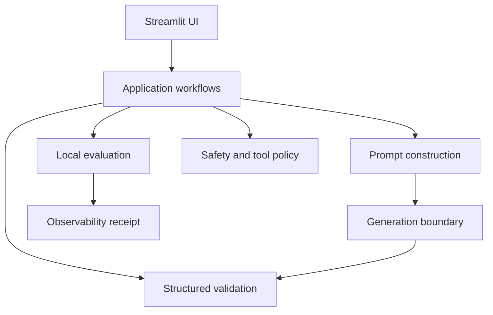

# Module 2 — Prompt Engineering & Structured Output Systems


A prompt-engineering and structured-output system built with production-grade engineering controls around explicit trust boundaries, deterministic evaluation, bounded prompting techniques, independent tool authorization, and evidence-aware observability.

## Executive Summary

**What:** Module 2 is a prompt-engineering system for building, validating, evaluating, and safely inspecting structured LLM interactions through deterministic local workflows.

**How:** Application-owned instructions, lower-trust prompt content, LangChain prompt templates, strict JSON parsing, JSON Schema, Pydantic validation, bounded advanced prompting techniques, deny-by-default tool policy, synthetic red-team fixtures, deterministic evaluation, and separated observability are composed behind explicit application boundaries.

**Why:** Prompt quality alone is insufficient for reliable AI systems. Module 2 demonstrates that model output, role framing, examples, detection findings, observability records, and tool proposals must remain subordinate to application-owned validation and authorization.

**Proof:** Reviewers can launch the offline Streamlit application, exercise four deterministic demonstrations, inspect retained failures and content-free evidence, test unauthorized tool proposals, and verify the accepted 28-requirement implementation and verification record.

## Start Here / Reviewer Path

**Hands-on reviewer path:** follow the [Module 2 User Guide](docs/USER_GUIDE.md) for exact launch instructions, UI controls, four walkthroughs, expected results, troubleshooting, evidence boundaries, and a ten-minute review sequence.

Module 2 is complete and released under the annotated Git tag `v0.2.0-module-2`.

The Streamlit application is intentionally offline and deterministic: it requires no account, API key, model download, or external service.

## Key Capabilities

- Application-owned prompt instructions separated from lower-trust request, context, and role framing
- LangChain prompt-template rendering with explicit prompt anatomy
- Strict JSON parsing, schema validation, and typed Pydantic validation
- Deterministic offline structured-generation workflow
- Decomposition, tree-style exploration, self-consistency, and ReAct under explicit budgets
- Deny-by-default tool authorization independent of model proposals
- Prompt-injection and jailbreak indicator detection kept separate from authorization
- Versioned synthetic attack/control simulations
- Deterministic evaluation with failed cases retained in applicable denominators
- Content-free canonical evidence export
- PromptLayer observability boundary separated from evaluation authority
- Explicit offline/mock/live integration modes in accepted adapters

## Architecture



The core package does not import Streamlit. Presentation is kept outside the reusable prompt, validation, safety, evaluation, and integration layers.

Primary components:

| Component | Responsibility |
| --- | --- |
| `prompts.construction` | Role-bearing prompt anatomy and trusted/lower-trust separation |
| `prompts.context` | Stable lexical context selection and bounded records |
| `prompts.techniques` | Bounded decomposition, candidate exploration, voting, and ReAct |
| `structured` | JSON parsing, schema validation, and strict typed contracts |
| `workflows` | Structured-generation and schema-lab orchestration |
| `safety` | Indicator detection, deny-by-default policy, tool sessions, and attack simulation |
| `evaluation` | Versioned cases, retained failures, deterministic metrics, and evidence export |
| `integrations` | Offline generation, OpenAI JSON Mode boundary, LangChain rendering, and PromptLayer boundary |

## Technology Stack

| Role | Technologies |
| --- | --- |
| Language and validation | Python 3.12, Pydantic, JSON Schema |
| Prompt construction | LangChain templates, application-owned prompt models |
| Structured output | Strict JSON parsing, schema validation, typed validation |
| Safety | Deny-by-default policy, bounded tools, synthetic red-team fixtures |
| Evaluation | Deterministic fixture executor, versioned cases, content-free evidence |
| Integrations | OpenAI JSON Mode adapter, PromptLayer adapter |
| Presentation | Streamlit |
| Testing and quality | pytest, Ruff, Python compilation validation |

## Production-Grade Engineering

- **Trust separation:** application-authored instructions remain distinct from user content, context, examples, and generated continuations.
- **Strict validation:** one bounded JSON document must pass parsing, schema checks, strict typed validation, and model invariants before acceptance.
- **Bounded execution:** advanced prompting techniques enforce provider-call, candidate, sample, and tool-execution limits.
- **Independent authorization:** model proposals cannot grant permissions, register handlers, or reset application policy.
- **Evaluation integrity:** failed applicable cases remain represented in metrics and exported evidence.
- **Evidence minimization:** canonical evaluation exports omit raw prompts, answers, arbitrary context, proposals, and exception bodies.
- **Observability separation:** PromptLayer outcomes are supplemental receipts and cannot rewrite evaluation, routing, safety, or tool authority.
- **Deterministic reviewer mode:** the UI uses authored offline fixtures so core behavior can be reproduced without external services.

## Security and Trust Boundaries

- Application Python code owns system policy, task instructions, output contracts, and tool permissions.
- Requests, context, role framing, examples, provider output, and model proposals remain lower-trust data.
- Lexical prompt-injection findings are diagnostic only; benign text can match and attacks can evade detection.
- Detection does not authorize tools. `SafetyPolicy` defaults to deny.
- Only application-registered local tools are available; no shell, arbitrary-code, filesystem, network, or credential tool is exposed by the Module 2 demonstrations.
- Structured validation establishes a boundary-time data contract, not factual correctness or execution authority.
- The UI and normal tests do not acquire live credentials.
- `.env` remains ignored and real credentials must not appear in examples or committed files.
- Private chain-of-thought is neither required nor exposed; explicit plans, summaries, candidates, votes, and observations are application-visible artifacts.

## Testing and Verification

Accepted Module 2 completion records include:

- 28 source requirements traced to implementation and verification evidence
- deterministic Streamlit reviewer workflows
- structured-output success and failure paths
- prompt-construction and role-boundary tests
- bounded advanced-technique tests
- authorization and tool-budget tests
- prompt-injection attack/control simulations
- deterministic evaluation and retained-failure checks
- content-free evidence validation
- offline and mocked integration verification
- Ruff, pytest, Python compilation, and Git diff checks

Normal verification requires no live credentials. Existing OpenAI JSON Mode and PromptLayer live configuration boundaries are implementation capabilities; Module 2 does not claim successful live provider requests or remote PromptLayer storage as part of the accepted release evidence.

For exact checkpoint counts and evidence, see [Verification](docs/VERIFICATION.md) and [Traceability](docs/TRACEABILITY.md).

## Run Locally

From the repository root:

```powershell
uv sync --locked
uv run streamlit run module-02/app.py --browser.gatherUsageStats false
```

Focused Module 2 verification:

```powershell
uv run pytest module-02/tests
```

Standalone deterministic prompt construction:

```powershell
uv run python -m prompt_engineering_systems.prompts
```

For an already synchronized environment without package-index contact, use `uv run --offline` or set `$env:UV_OFFLINE='true'` for the session.

## Documentation / Deep Dives

- [User Guide](docs/USER_GUIDE.md) — hands-on reviewer walkthroughs and expected results
- [Architecture](docs/ARCHITECTURE.md)
- [Source requirements](docs/SOURCE_REQUIREMENTS.md)
- [Traceability](docs/TRACEABILITY.md)
- [Verification](docs/VERIFICATION.md)
- [Portfolio README](../README.md)
- Source: [`src/prompt_engineering_systems/`](src/prompt_engineering_systems/), [`app.py`](app.py), [`tests/`](tests/)

<details>
<summary><strong>External Integration Boundaries</strong></summary>

These interfaces exist in accepted source and are verified through deterministic local or mocked tests. Live capability does not imply a successful live request, current remote-model availability, or remote evidence storage.

| Integration | Accepted local/mock evidence | Live boundary |
| --- | --- | --- |
| OpenAI JSON Mode | Offline provider plus mocked SDK tests verify role preservation, JSON response mode, bounded completion, and safe error translation. | Requires an application-owned configured SDK client. The adapter does not acquire credentials from the UI. |
| LangChain | Real local `PromptTemplate` rendering with fixed templates and literal values. | No model/service contact is part of this rendering path. |
| PromptLayer | Offline mode skips network contact; mocked mode uses explicit synthetic credentials and mock transport. | Live mode requires an explicitly supplied caller-owned key and fixed HTTPS boundary. |

</details>

## Evidence and Limitations

- Context selection and tree scoring are lexical instructional algorithms, not semantic retrieval or model confidence.
- Character budgets are not token counts.
- Self-consistency vote share is not calibrated confidence.
- Technique and evaluation datasets are small, deterministic, and synthetic; they demonstrate repeatable engineering behavior, not general model quality or security performance.
- Prompt-injection detection is not claimed to be universal.
- The bounded schema layer intentionally supports a restricted subset and rejects unsupported constructs.
- External live behavior remains unverified for Module 2, and the Streamlit UI never contacts the live adapters.

For the six-system engineering progression and links to the other modules, see the [portfolio README](../README.md).

---

Developed from Techademy AI Engineering program requirements. Independent
implementation and engineering enhancements.
