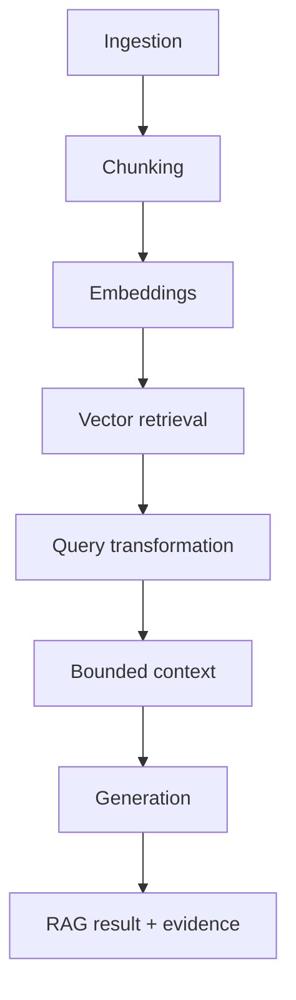

# Module 3 — RAG Engineering Foundations


A retrieval-augmented generation system built with production-grade engineering controls around provenance, explicit trust boundaries, bounded context assembly, provider-neutral retrieval interfaces, deterministic reviewer workflows, and evidence-aware integration claims.

## Executive Summary

**What:** Module 3 implements the foundations of a retrieval-augmented generation system as separate, inspectable stages: ingestion, chunking, embeddings, vector retrieval and stores, query transformation, bounded context assembly, generation, end-to-end RAG orchestration, and corpus-refresh knowledge freshness.

**How:** Immutable provenance, three chunking strategies, deterministic local embeddings, genuine local FAISS and ChromaDB integrations, an offline Pinecone adapter boundary, query transformation, rank-preserving context optimization, a deterministic extractive generator, and both core and LangChain RAG paths are composed behind explicit package boundaries.

**Why:** Reliable RAG requires more than retrieving text. Source identity, chunk boundaries, vector metrics, provider outputs, context limits, generated answers, and external content must remain observable and subordinate to application-owned policy.

**Proof:** Reviewers can exercise nine Streamlit demonstrations, run seven standalone examples, compare core and LangChain execution, inspect exact retrieval and citation evidence, test adversarial query text, and trace the accepted 28 requirements through the verification record.

## Start Here / Reviewer Path

**Hands-on reviewer path:** follow the [Module 3 User Guide](docs/USER_GUIDE.md) for exact launch instructions, all nine demonstrations, expected results, troubleshooting, evidence boundaries, and a focused 15-minute review sequence.

Module 3 implementation and Stories 1–10 are complete and released under the annotated Git tag `v0.3.0-module-3`.

The default Streamlit path is offline and credential-free. The only reviewer-initiated live-provider path is the optional OpenAI Embeddings panel; it is not required for normal verification.

## Key Capabilities

- Deterministic ingestion with stable document identity and provenance
- Fixed, recursive, and semantic chunking strategies
- Explicit embedding dimensions and vector similarity / distance metrics
- Genuine local exact FAISS vector search
- Genuine local ephemeral ChromaDB storage and retrieval
- Pinecone adapter verification through deterministic offline fixtures and genuine SDK types
- Query decomposition, merged retrieval, and deduplication
- Rank-preserving whole-chunk context optimization under explicit bounds
- Core RAG and genuine LangChain sequencing over the same domain stages
- Citation-bearing deterministic extractive generation
- Corpus-refresh knowledge-freshness demonstration
- Optional reviewer-initiated OpenAI Embeddings adapter exercise

## Architecture



The reusable `rag_engineering_foundations` package owns domain behavior. `module-03/app.py` is a presentation layer and does not reimplement ingestion, chunking, embedding, retrieval, context-selection, or generation algorithms.

Primary components:

| Component | Responsibility |
| --- | --- |
| `ingestion.py` | Validated source ingestion, stable identity, provenance, and metadata separation |
| `chunking.py` | Fixed, recursive, and semantic chunking contracts |
| `embeddings.py` / `vectors.py` | Deterministic embeddings and vector metric operations |
| `faiss_index.py` | Genuine local exact FAISS search |
| `chroma_index.py` | Genuine local ephemeral ChromaDB adapter |
| `pinecone_index.py` | Pinecone provider boundary with deterministic offline verification |
| `query_transformation.py` | Derived retrieval-query construction |
| `context_optimization.py` | Rank-preserving, whole-chunk context bounds |
| `rag_pipeline.py` | Core end-to-end RAG orchestration |
| `langchain_rag.py` | Genuine LangChain sequencing over the same domain stages |
| `generation.py` | Deterministic extractive generation with citation evidence |
| `openai_embeddings.py` | Explicit OpenAI Embeddings adapter boundary |

## Technology Stack

| Role | Technologies |
| --- | --- |
| Language and contracts | Python 3.12, immutable domain models, explicit validation |
| Retrieval | FAISS, ChromaDB, Pinecone SDK boundary |
| Embeddings | `LocalHashEmbedder`, optional OpenAI Embeddings adapter |
| RAG orchestration | Core Python pipeline, LangChain |
| Presentation | Streamlit |
| Testing and quality | pytest, Ruff, Python compilation validation, executable examples |

## Production-Grade Engineering

- **Stage isolation:** ingestion, chunking, embedding, retrieval, context, and generation remain separate testable components.
- **Deterministic provenance:** stable source and content identities make later chunks and citations traceable.
- **Provider-neutral contracts:** FAISS, ChromaDB, and Pinecone adapters satisfy shared retrieval interfaces.
- **Bounded context:** context assembly preserves ranking and whole chunks under explicit character and chunk limits.
- **Failure-path validation:** malformed dimensions, identities, metrics, namespaces, provider responses, and domain errors are tested.
- **Framework separation:** LangChain sequences accepted domain stages rather than becoming a second source of business logic.
- **Evidence classification:** genuine local integrations, deterministic stand-ins, offline adapters, and optional live-provider behavior are explicitly distinguished.
- **Deterministic reviewer mode:** the default UI can be reviewed without provider credentials or external services.

## Security and Trust Boundaries

- Document text, queries, retrieved chunks, metadata, and generated content remain untrusted data.
- Retrieved content cannot choose providers, credentials, imports, execution paths, or application instructions.
- Caller metadata remains separate from derived provenance and does not acquire authority over source identity.
- Query transformation does not derive policy from retrieved content.
- Retrieval and store outputs are validated for identity, dimensions, finite metrics, namespace, and malformed provider output.
- Context optimization preserves complete chunks and explicit exclusions rather than silently truncating evidence.
- Injection-style strings are exercised through the RAG paths as data, not instructions.
- The Streamlit UI does not render untrusted content through unsafe HTML.
- Provider failures are translated without exposing raw payloads or credentials.
- These controls establish application trust boundaries; Module 3 does not claim universal prompt-injection immunity.

## Testing and Verification

Accepted Module 3 completion records include:

- 28 source requirements traced to implementation and evidence
- deterministic and failure-path ingestion verification
- fixed, recursive, and semantic chunking tests
- embedding and vector-metric validation
- genuine local FAISS verification
- genuine local ephemeral ChromaDB verification
- deterministic Pinecone adapter verification
- query-transformation and bounded-context tests
- core and LangChain RAG equivalence checks
- adversarial-data and trust-boundary tests
- seven runnable examples
- Streamlit human-review acceptance
- Ruff, pytest, Python compilation, and Git diff checks

At the Story 10 closeout on 2026-10-03, the **full repository** suite passed with **1054 tests** and three accepted ChromaDB deprecation warnings. That count is a repository-wide checkpoint, not a Module 3-only test count.

For exact checkpoint evidence, see [Verification](docs/VERIFICATION.md) and [Traceability](docs/TRACEABILITY.md).

## Run Locally

From the repository root:

```powershell
uv sync --locked
uv run streamlit run module-03/app.py --browser.gatherUsageStats false
```

Focused Module 3 verification:

```powershell
uv run pytest module-03/tests
```

A standalone knowledge-freshness example:

```powershell
uv run python module-03/examples/rag_freshness.py
```

The remaining examples under [`examples/`](examples/) cover chunking comparison, embedding metrics, vector search, Chroma search, offline Pinecone, and the query/context pipeline.

## Documentation / Deep Dives

- [User Guide](docs/USER_GUIDE.md) — hands-on reviewer walkthroughs and expected results
- [Architecture](docs/ARCHITECTURE.md)
- [Source requirements](docs/SOURCE_REQUIREMENTS.md)
- [Traceability](docs/TRACEABILITY.md)
- [Verification](docs/VERIFICATION.md)
- [Story 10 closeout](docs/STORY_10.md)
- [Portfolio README](../README.md)
- Source: [`src/rag_engineering_foundations/`](src/rag_engineering_foundations/), [`app.py`](app.py), [`examples/`](examples/), [`tests/`](tests/)

<details>
<summary><strong>Integration Evidence Boundaries</strong></summary>

| Integration | Established evidence | Not established |
| --- | --- | --- |
| FAISS | Genuine local `IndexFlatIP` / `IndexFlatL2` add and search, ranking and invalid-output handling | Distributed deployment, persistence, ANN performance |
| ChromaDB | Genuine local ephemeral collection, configured metrics, retrieval, and cleanup | Remote Chroma, durability, production-scale recall or latency |
| Pinecone | Genuine SDK / adapter boundary exercised with deterministic offline fixtures | Live Pinecone service verification |
| OpenAI Embeddings | Genuine adapter with deterministic offline request / response verification; optional reviewer-initiated live UI path exists | Accepted release evidence does not establish successful live API execution or semantic-quality results |
| LangChain | Genuine local `RunnableSequence` orchestration with real end-to-end Module 3 output | Remote LLM generation, framework agents, or framework tools |

</details>

## Evidence and Limitations

- `LocalHashEmbedder` is a deterministic lexical hash implementation, not a trained semantic model.
- The semantic chunking signal is a small application-authored teaching vocabulary, not a trained similarity model.
- `LocalExtractiveGenerator` copies supplied evidence and is not a production language model.
- Character budgets are not token budgets.
- FAISS is exact local search; approximate-nearest-neighbor performance is not established.
- ChromaDB is used ephemerally; durability is not established.
- Pinecone behavior is verified through an offline adapter fixture; live remote Pinecone behavior is not established.
- OpenAI adapter capability exists and the UI offers an optional reviewer-initiated live exercise, but successful live OpenAI execution is not part of the accepted Module 3 release evidence.
- Fixture scores and receipts are not measured remote-service behavior.
- Retrieval and generation do not establish source truth.
- RAG freshness depends on refreshing the underlying corpus or index; it is not model retraining.

For the six-system engineering progression and links to the other modules, see the [portfolio README](../README.md).

---

Developed from Techademy AI Engineering program requirements. Independent
implementation and engineering enhancements.
