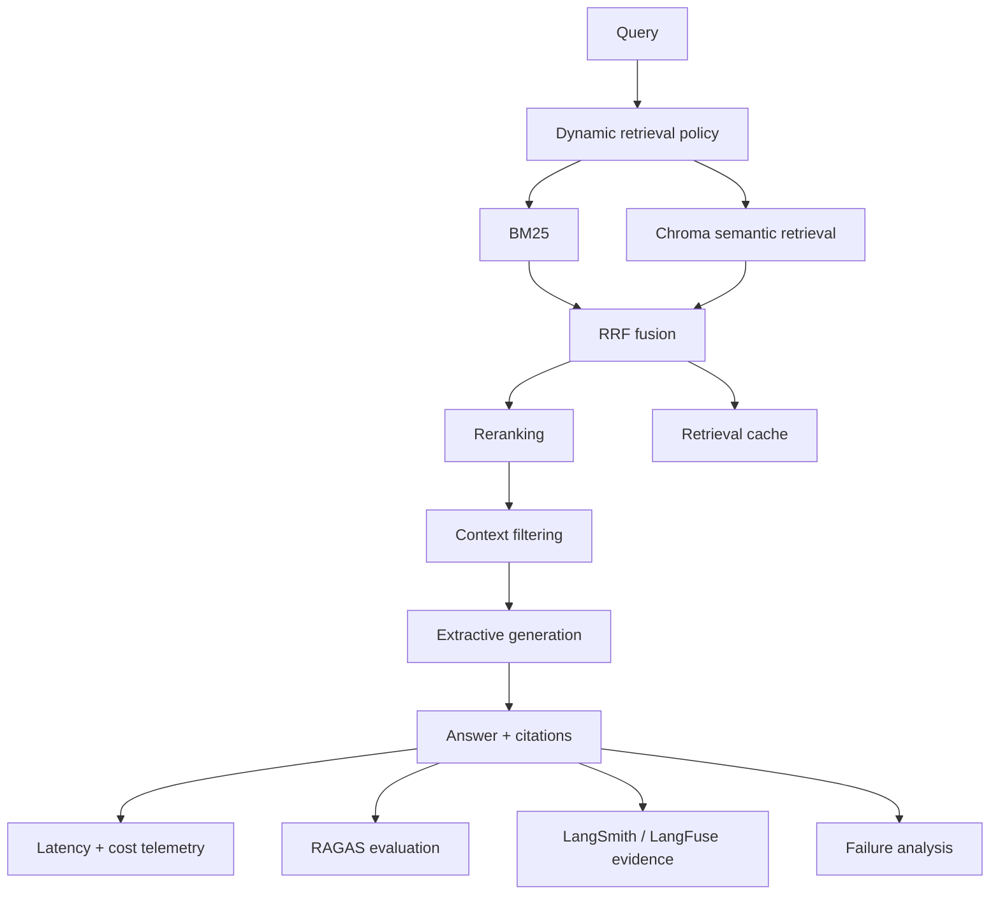

# Module 4 — Advanced RAG & Evaluation Systems


A production-grade hybrid RAG and evaluation system that makes retrieval decisions, ranking evidence, context selection, telemetry, evaluation, observability, and failure behavior inspectable rather than implicit.

## Executive Summary

**What:** Module 4 implements an advanced hybrid RAG workflow with dynamic retrieval, BM25 lexical retrieval, ChromaDB semantic retrieval, Reciprocal Rank Fusion, reranking, context filtering, retrieval caching, extractive generation, latency and cost telemetry, RAGAS evaluation, LangSmith tracing, LangFuse monitoring, and failure analysis.

**How:** The system composes independently testable package components behind explicit contracts. The Streamlit dashboard consumes those accepted contracts and exposes a 12-section evidence view covering the answer, retrieval path, fusion, reranking, filtering, cache state, telemetry, evaluation, observability, and faults.

**Why:** A useful RAG system must be measurable as well as functional. Module 4 makes ranking, latency, estimated cost, evaluation provenance, observability boundaries, and failure behavior visible so reviewers can distinguish measured behavior from fixtures, estimates, offline integrations, and unavailable live services.

**Proof:** Reviewers can run the complete workflow without credentials, inspect citation provenance through BM25/semantic/RRF/reranking/filtering stages, reproduce cache hits, compare RAGAS fixture expectations with genuine metric execution, inject fatal and nonfatal failures, and verify that LangSmith/LangFuse SDK paths remain explicitly offline.

## Start Here / Reviewer Path

Module 4 Stories 1–12 are complete and released under the annotated Git tag `v0.4.0-module-4`.

All 29 source requirements are accounted for: 26 complete and 3 complete with approved limitations covering LangSmith, LangFuse, and Pinecone. The accepted human Streamlit verification recorded PASS on 2026-10-08.

For the fastest hands-on review, use the [Module 4 User Guide](docs/USER_GUIDE.md). It includes exact launch instructions, dashboard walkthroughs, expected results, evidence interpretations, failure-injection exercises, troubleshooting, and a focused 15-minute reviewer path.

The default dashboard is deterministic, offline, and credential-free. The optional cross-encoder may download a genuine sentence-transformers model and run it locally.

## Key Capabilities

- Dynamic query-dependent retrieval breadth
- BM25 lexical retrieval
- Genuine local ephemeral ChromaDB semantic retrieval
- Reciprocal Rank Fusion across lexical and semantic legs
- Deterministic overlap reranking by default
- Optional genuine local sentence-transformers cross-encoder
- Explicit context filtering with retained/excluded evidence
- Reviewer-visible in-memory retrieval caching
- Grounded extractive generation with citations
- Measured local stage latency
- Estimated usage and cost with fixture pricing
- Genuine RAGAS execution over fixed replay judgments
- Genuine LangSmith SDK serialization through an offline transport
- Genuine LangFuse SDK serialization through an offline transport
- Failure analysis that distinguishes fatal workflow failures from nonfatal observability failures
- Evidence provenance labels that identify measured, estimated, fixture, offline, local-model, unavailable, and not-evaluated states

## Architecture



The reusable `advanced_rag_evaluation` package owns authoritative behavior. `module-04/app.py` is a presentation/orchestration consumer: it invokes public package APIs and renders returned contracts rather than reimplementing retrieval, ranking, filtering, generation, evaluation, or observability logic.

Primary components:

| Component | Responsibility |
| --- | --- |
| `dynamic_retrieval.py` | Deterministic query-dependent retrieval policy |
| `bm25.py` | Lexical retrieval |
| `semantic_retrieval.py` | Local ChromaDB semantic retrieval |
| `hybrid_retrieval.py` | Reciprocal Rank Fusion |
| `reranking.py` | Deterministic reranker and optional cross-encoder boundary |
| `context_filtering.py` | Score/count-based context retention and exclusion evidence |
| `retrieval_cache.py` | In-memory retrieval caching |
| `advanced_rag_pipeline.py` | End-to-end workflow orchestration and stage contracts |
| `generation.py` | Extractive, citation-bearing generation |
| `telemetry/` | Latency and cost evidence |
| `evaluation/` | RAGAS integration and replay-judge evaluation |
| `observability/` | LangSmith, LangFuse, and failure-analysis integrations |
| `app.py` | Reviewer-facing Streamlit dashboard |

Module 4 is standalone and does not import Modules 1–3; an isolation test enforces that boundary.

## Technology Stack

| Role | Technologies |
| --- | --- |
| Language and contracts | Python 3.12, typed immutable/domain contracts, explicit validation |
| Lexical retrieval | BM25 |
| Semantic retrieval | ChromaDB with deterministic local hash embeddings |
| Hybrid retrieval | Reciprocal Rank Fusion |
| Reranking | Deterministic token-overlap scorer; optional sentence-transformers cross-encoder |
| Evaluation | RAGAS with fixed replay judgments |
| Observability | LangSmith SDK, LangFuse SDK, offline transports |
| Provider boundary | Pinecone SDK with deterministic offline verification |
| Telemetry | `perf_counter`-based latency, heuristic token/cost estimation |
| Presentation | Streamlit |
| Quality | pytest, Ruff, Python compilation validation, Git diff checks |

## Production-Grade Engineering

- **Stage isolation:** retrieval policy, lexical retrieval, semantic retrieval, fusion, reranking, filtering, generation, telemetry, evaluation, and observability remain independently testable.
- **Evidence-first contracts:** ranking, scores, exclusions, citations, telemetry, and evaluation metadata are retained for inspection rather than hidden behind a final answer.
- **Provider-neutral boundaries:** external/provider integrations are wrapped so deterministic local or offline verification does not require pretending remote delivery occurred.
- **Retrieval caching:** repeated compatible retrievals can return from an in-memory cache with reviewer-visible cache state.
- **Measured vs. estimated telemetry:** latency is measured during the run; cost is estimated using a documented heuristic and fixture pricing.
- **Failure classification:** fatal workflow faults prevent an invalid answer, while nonfatal observability faults preserve an otherwise valid result.
- **Evaluation eligibility:** RAGAS is skipped with an explicit reason when a custom or modified run no longer matches the fixed replay-judgment contract.
- **Module isolation:** Module 4 imports no earlier academic module.
- **Deterministic reviewer mode:** normal dashboard verification requires no credentials, LLM, remote provider, or network access.
- **Evidence classification:** local execution, fixtures, estimates, offline SDK evidence, optional local models, unavailable capabilities, and not-evaluated states are explicitly distinguished.

## Security and Trust Boundaries

- Retrieved text, generated text, judge text, provider data, and custom queries remain untrusted data.
- Untrusted content is displayed through plain text, code, dataframe, and metric components rather than interpreted Markdown or HTML.
- A deliberately adversarial built-in passage remains inert data even though it contains instruction-like text, Markdown image syntax, and an HTML `<script>` fragment.
- Retrieved content cannot select credentials, providers, imports, application policy, or execution paths.
- The dashboard reads no credential, environment variable, or secret.
- Raw exception text and tracebacks are not exposed in the Streamlit UI.
- Dynamic retrieval and filtering policy are application-owned and are not derived from retrieved content.
- LangSmith and LangFuse serialization is checked for query, answer, and passage-text leakage.
- Observability failures are sanitized and classified without discarding a valid result.
- These controls establish application trust boundaries; they do not claim universal prompt-injection immunity or universal data-exfiltration prevention.

## Testing and Verification

Accepted Module 4 completion evidence includes:

- 29 source requirements accounted for
- 26 complete requirements
- 3 complete-with-approved-limitation requirements for LangSmith, LangFuse, and Pinecone
- deterministic dynamic-retrieval tests
- BM25 retrieval tests
- genuine local ChromaDB retrieval tests
- Reciprocal Rank Fusion tests
- reranking and context-filtering tests
- retrieval-cache tests
- latency and cost telemetry tests
- RAGAS integration tests
- LangSmith and LangFuse offline-integration tests
- failure-analysis tests
- module-isolation enforcement
- nine offline example/demo executions
- human Streamlit verification: PASS on 2026-10-08
- Ruff, pytest, Python compilation, and Git diff checks
- Definition of Done: 27 of 27 at release closeout

At the 2026-10-08 release checkpoint, the **full repository** suite passed with **1844 tests** and three accepted ChromaDB deprecation warnings. That is a repository-wide checkpoint, not a Module 4-only test count.

The closeout did not run the opt-in cross-encoder verification path.

For exact evidence, see [Verification](docs/VERIFICATION.md), [Traceability](docs/TRACEABILITY.md), and [Story 12 closeout](docs/STORY_12.md).

## Run Locally

From the repository root:

```powershell
uv sync --locked
uv run streamlit run module-04/app.py --browser.gatherUsageStats false
```

Focused Module 4 verification:

```powershell
uv run pytest module-04/tests
```

Run the end-to-end offline example:

```powershell
uv run python module-04/examples/hybrid_rag_workflow.py
```

The remaining examples under [`examples/`](examples/) cover BM25, hybrid retrieval, reranking, optimization, telemetry, RAGAS, LangSmith, and LangFuse.

The cross-encoder verification path is explicitly opt-in and may download a model from Hugging Face.

## Documentation / Deep Dives

- [User Guide](docs/USER_GUIDE.md) — hands-on reviewer walkthroughs, expected results, evidence labels, failure exercises, and troubleshooting
- [Architecture](docs/ARCHITECTURE.md)
- [Source requirements](docs/SOURCE_REQUIREMENTS.md)
- [Traceability](docs/TRACEABILITY.md)
- [Verification](docs/VERIFICATION.md)
- [Story 12 closeout](docs/STORY_12.md)
- [Portfolio README](../README.md)
- Source: [`src/advanced_rag_evaluation/`](src/advanced_rag_evaluation/), [`app.py`](app.py), [`examples/`](examples/), [`tests/`](tests/)

<details>
<summary><strong>Integration Evidence Boundaries</strong></summary>

| Integration / capability | Established evidence | Not established |
| --- | --- | --- |
| BM25 | Genuine local lexical retrieval | Remote-service behavior |
| ChromaDB | Genuine local ephemeral semantic retrieval | Remote Chroma, durability, production-scale recall/latency |
| Semantic embeddings | Deterministic local token-overlap hashing | Learned semantic quality |
| Default reranker | Deterministic local token-overlap scoring | Learned reranking quality |
| Cross-encoder | Genuine sentence-transformers implementation is available as an opt-in local path | Accepted closeout did not exercise the opt-in verification run |
| RAGAS | Genuine metric execution over fixed replay judgments | Provider/model judge quality |
| LangSmith | Genuine SDK serialization into a sealed offline transport | Hosted delivery, remote run URL, live console verification |
| LangFuse | Genuine SDK serialization into a sealed offline transport | Hosted delivery, live console verification |
| Pinecone | Genuine SDK/provider boundary with deterministic offline verification | Live Pinecone service/index verification |
| Latency | Measured locally during the current workflow | Hosted production latency/SLO evidence |
| Cost | Heuristic usage estimate with fixture pricing | Provider billing or provider-reported token usage |
| Generation | Extractive, grounded, citation-bearing output | LLM-generated answer quality |

</details>

## Evidence and Limitations

- The default dashboard uses deterministic local hash embeddings; it does not establish learned semantic similarity.
- The default reranker uses deterministic token overlap; it is not a learned model.
- The optional sentence-transformers cross-encoder is a genuine local model path, may download model files, and was not part of the accepted closeout execution evidence.
- Generation is extractive, not LLM-generated.
- RAGAS genuinely computes metrics, but the dashboard judge replays fixed human-authored verdicts rather than invoking a provider-backed semantic judge.
- Latency values are measured on the current machine and are not hosted production benchmarks.
- The one-second per-stage latency budgets are illustrative demo thresholds.
- Cost is estimated from a heuristic usage convention and fixture pricing, not provider billing.
- The retrieval cache is in-memory and per session; persistence, eviction, TTL, and hit-ratio statistics are not claimed.
- LangSmith and LangFuse use genuine SDK integrations verified offline. `remote_delivery_verified=False` means hosted delivery is not established.
- Pinecone is not exercised by the dashboard and requires credentials plus a live index for remote use.
- Live LangSmith, LangFuse, and Pinecone verification was outside the accepted final Module 4 scope.
- Retrieval and evaluation evidence do not establish source truth.
- The full-repository 1844-test checkpoint must not be interpreted as a Module 4-only test count.

For the six-system engineering progression and the other standalone modules, see the [portfolio README](../README.md).

---

Developed from Techademy AI Engineering program requirements. Independent implementation and engineering enhancements.
