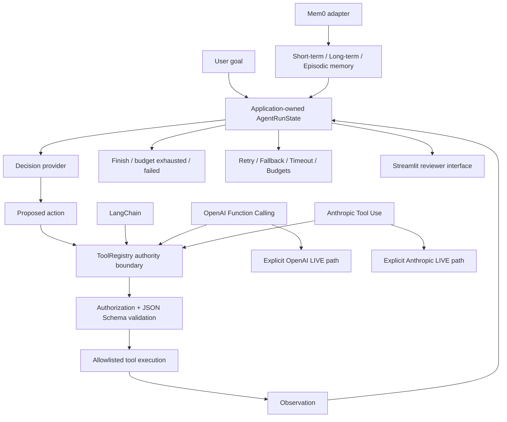

# Module 5 — AI Agent Engineering


A production-grade, stateful, bounded, tool-using agent system with application-owned authority, three memory layers, reliability controls, provider integrations, explicit live-provider authorization, and a four-tab Streamlit reviewer interface.

## Executive Summary

**What:** Module 5 implements an application-owned ReAct agent lifecycle with bounded autonomous execution, allowlisted tools, schema validation, short-term/long-term/episodic memory, LangChain/OpenAI/Anthropic tool-use integrations, Mem0 integration, retry/fallback/timeout primitives, and reviewer-visible workflow state.

**How:** Models and providers may propose actions, but the application decides what is executable. Every tool call returns through `ToolRegistry`, provider output and recalled memory remain untrusted data, agent execution is budgeted, and live provider paths require explicit session-only human authorization.

**Why:** Tool-using agents become risky when provider output can silently acquire authority, retries are unbounded, state is opaque, or evidence classes are blurred. Module 5 makes authority, memory, failure behavior, provider boundaries, live execution, and evidence provenance explicit and inspectable.

**Proof:** Reviewers can run multi-step autonomous workflows, inspect application-visible decision records and state, verify memory continuity, compare LangChain/OpenAI/Anthropic tool-calling paths, deny hostile tool proposals, exercise bounded reliability scenarios, run genuine local Mem0 under offline safeguards, and optionally execute independently bounded OpenAI or Anthropic LIVE workflows with their own credentials.

## Start Here / Reviewer Path

The original source-complete Module 5 release is preserved by the immutable annotated tag `v0.5.0-module-5`. All 30 source requirements were traced to implementation, tests, and verification evidence at that release.

A later production-grade upgrade was published to `main` **without moving the release tag**. It added session-only provider credential authorization, explicit bounded OpenAI and Anthropic live paths, integrated retry and fallback behavior, runtime state reconciliation, production-control verification, and deployment verification. Its documented verdict is production-ready **for the documented Streamlit deployment scope**.

**Public Streamlit application:** https://dm-aiep-module-05.streamlit.app/

For the fastest hands-on review, follow the [Module 5 User Guide](docs/USER_GUIDE.md). It provides exact zero-key launch instructions, six walkthroughs, expected outcomes, security tests, live-provider boundaries, genuine local Mem0 instructions, troubleshooting, and a focused 10-minute reviewer path.

Recommended reviewer sequence:

1. run the autonomous ReAct + calculator workflow;
2. inspect memory continuity;
3. compare LangChain, OpenAI, and Anthropic deterministic integrations;
4. confirm a hostile `shell` proposal is denied;
5. run representative reliability scenarios;
6. optionally exercise a live provider only if you intentionally want a potentially billable call.

## Key Capabilities

- Bounded application-owned ReAct lifecycle
- Multi-step dynamic tool selection
- Immutable application-visible decision records
- Typed workflow state and terminal-state reconciliation
- Application-owned `ToolRegistry` as the sole tool-execution authority
- JSON Schema validation before tool execution
- Unknown-tool and injected-argument denial
- Short-term session memory
- Long-term fact memory
- Episodic run memory
- Mem0 adapter with per-user scoping
- Genuine local Mem0 mode under offline safeguards
- Genuine LangChain `create_agent` runtime with a local scripted chat model
- Genuine OpenAI SDK function-calling integration
- Genuine Anthropic SDK tool-use integration
- Deterministic in-process mock transports for zero-cost provider demonstrations
- Explicit session-authorized OpenAI LIVE path
- Explicit session-authorized Anthropic LIVE path
- Bounded retries for retryable failures
- Explicit fallback behavior
- Cancelling timeout primitive for awaitable work
- Agent step budgets
- Reviewer-visible reliability classifications
- Zero-key default Streamlit startup
- Explicit separation of deterministic, mocked, local, and live evidence

## Architecture



The reusable `ai_agent_engineering` package owns authoritative agent, memory, provider, tool, and resilience behavior. `module-05/app.py` is a reviewer-facing presentation/orchestration layer over those accepted components.

Primary components:

| Component | Responsibility |
| --- | --- |
| `models.py` | `AgentRunState`, statuses, typed workflow state |
| `agent/lifecycle.py` | Validated state transitions |
| `agent/react.py` | Explicit agent decisions and decision records |
| `agent/runner.py` | Bounded ReAct execution loop |
| `tools/schemas.py` | Tool definitions and JSON Schema contracts |
| `tools/registry.py` | Application-owned allowlist and execution authority |
| `tools/builtins.py` | Calculator, knowledge lookup, note lookup |
| `memory/short_term.py` | Bounded session context |
| `memory/long_term.py` | Persistent-in-process facts |
| `memory/episodic.py` | Previous-run records |
| `memory/mem0_adapter.py` | Application-owned Mem0 contract |
| `providers/openai_tools.py` | OpenAI tool/function-calling loop |
| `providers/anthropic_tools.py` | Anthropic tool-use loop |
| `integrations/langchain_agent.py` | LangChain agent integration |
| `resilience/` | Retry, timeout, and fallback primitives |
| `app.py` | Four-tab Streamlit reviewer interface |

Module 5 is standalone and imports nothing from Modules 1–4.

## Technology Stack

| Role | Technologies |
| --- | --- |
| Language and state | Python 3.12, dataclasses/Pydantic-style typed contracts |
| Agent lifecycle | Application-owned ReAct workflow |
| Tool authority | `ToolRegistry`, JSON Schema |
| Agent integration | LangChain `create_agent` |
| Provider SDKs | OpenAI Responses API, Anthropic Messages API |
| Memory | Native short-term/long-term/episodic memory, Mem0 adapter |
| Genuine local memory backend | Mem0 2.2.1, local Qdrant, cached Hugging Face embedder |
| Reliability | Retry, fallback, cancelling async timeout, step budgets |
| Presentation | Streamlit |
| Quality | pytest, Ruff, Python compilation validation, Git diff checks |

## Production-Grade Engineering

- **Application-owned authority:** provider/model output may propose an action but cannot execute it directly.
- **Central tool boundary:** all autonomous, LangChain, OpenAI, and Anthropic tool calls pass through `ToolRegistry`.
- **Pre-execution validation:** unknown tools, unauthorized tools, extra arguments, and invalid values are rejected before handler execution.
- **Bounded autonomy:** agent runs have explicit step budgets and terminate as `completed`, `budget_exhausted`, or a typed failure.
- **Visible execution state:** lifecycle transitions, selected tools, observations, decision records, retry counts, fallback history, terminal failures, and final results remain application-visible.
- **Memory without authority:** short-term, long-term, episodic, and Mem0-recalled information are context only.
- **Bounded provider loops:** OpenAI and Anthropic paths cap provider requests and tool calls.
- **Live execution separation:** deterministic/mock-backed demonstrations remain distinct from explicit potentially billable LIVE actions.
- **Session-only credentials:** live-provider credentials exist only in Streamlit session state and are separately authorized from execution.
- **Retry discipline:** only configured retryable failures are retried; validation and authorization failures are not treated as transient.
- **Fallback visibility:** fallback use is explicit and recorded.
- **Timeout discipline:** `run_with_timeout` provides a genuinely cancelling deadline for awaitable operations; ambiguous synchronous decision-provider timeouts are not automatically replayed.
- **Fail-closed behavior:** denied or failing tool calls are never reported as successful execution.
- **Evidence discipline:** deterministic, mocked-transport, genuine-local, and genuine-live evidence are labelled separately.
- **Cost control:** normal reviewer operation is zero-cost; live execution is explicit, finite, potentially billable, and SDK retries are disabled.

## Security and Trust Boundaries

- `ToolRegistry` is the sole tool-execution authority for the core runner and all provider integrations.
- Provider output, model output, user goals, tool output, and memory are treated as untrusted data.
- Provider/model output cannot register tools, modify the allowlist, or grant itself execution authority.
- Unknown tools such as an invented `shell` call are denied before execution.
- Tool arguments must pass JSON Schema validation; injected extra arguments are rejected.
- The application exposes no arbitrary shell, `eval`, `exec`, or filesystem execution tool.
- User-controlled text is rendered as plain text, code, JSON, or dataframe content rather than interpreted Markdown.
- Normal startup is zero-key.
- OpenAI and Anthropic credentials are masked, session-only, and explicitly authorized by the user.
- Authorizing a credential does not itself make a provider request.
- A separate LIVE action is required before a potentially billable provider call occurs.
- Live request bodies are intentionally not retained or displayed.
- Raw provider exception text is not reflected into the UI; provider failures are sanitized.
- SDK retries are disabled on live provider clients.
- Provider request counts and tool-call counts are bounded.
- Genuine Mem0 refuses to start unless telemetry is disabled and Hugging Face Hub access is offline.
- Automated live tests require both an explicit live-test flag and the corresponding credential.
- These controls establish the tested application authority and trust boundaries; they do not claim universal prompt-injection immunity, formal compliance certification, or protection beyond the documented architecture.

## Testing and Verification

Accepted source-complete release evidence includes:

- 30 source requirements traced
- Stories 1–11 complete and human-approved
- Ruff: PASS
- pytest: `224 passed, 4 skipped`
- compileall: PASS
- offline Mem0 overlay: `227 passed, 1 skipped`
- non-loopback network attempts during the accepted offline evidence run: `0`
- deterministic autonomous-agent verification
- tool-authority and schema-validation tests
- memory tests
- LangChain integration tests
- OpenAI mocked-transport tests
- Anthropic mocked-transport tests
- retry/fallback/timeout tests
- hostile-tool and injected-argument denial tests
- module-isolation evidence
- Streamlit reviewer demonstration

The later production-grade upgrade added separate verification for:

- session-only credential handling
- explicit live-provider authorization
- bounded OpenAI LIVE execution
- bounded Anthropic LIVE execution
- integrated retry and fallback state
- runtime state reconciliation
- published Streamlit deployment controls
- genuine successful OpenAI and Anthropic live-provider workflows under explicit human authorization

The live-test gate was left disabled after verification so ordinary test runs remain zero-key and do not make remote provider calls.

For exact historical and production-readiness evidence, see [Verification](docs/VERIFICATION.md) and [Production Readiness](docs/PRODUCTION_READINESS.md).

## Run Locally

### Ordinary zero-key UI

From the repository root:

```powershell
.\.venv\Scripts\python.exe -m streamlit run module-05/app.py
```

No API key is required to start.

The default autonomous-agent, reliability, LangChain, OpenAI mocked-transport, Anthropic mocked-transport, and Mem0 stand-in demonstrations remain available without live provider calls.

### Focused Module 5 verification

```powershell
.\.venv\Scripts\ruff.exe check module-05
$env:PYTHONPATH='module-05/src'; .\.venv\Scripts\python.exe -m pytest module-05/tests -q -p no:cacheprovider
.\.venv\Scripts\python.exe -m compileall -q module-05/app.py module-05/src module-05/tests
```

### Genuine local Mem0

```powershell
$env:MEM0_TELEMETRY='False'; $env:HF_HUB_OFFLINE='1'; uv run --offline --no-sync --with mem0ai==2.2.1 streamlit run module-05/app.py --server.fileWatcherType none
```

Then open **Memory** and press **Start genuine local Mem0**.

### Optional live-provider mode

Open **Tool Integrations**, authorize your own provider credential for the current Streamlit session, and press the separately labelled OpenAI LIVE or Anthropic LIVE action.

Live actions may consume provider quota or incur cost.

## Documentation / Deep Dives

- [User Guide](docs/USER_GUIDE.md) — reviewer walkthroughs, live-provider usage, Mem0, reliability, expected outcomes, and troubleshooting
- [Source Requirements](docs/SOURCE_REQUIREMENTS.md)
- [Architecture](docs/ARCHITECTURE.md)
- [Traceability](docs/TRACEABILITY.md)
- [Verification](docs/VERIFICATION.md)
- [Production Readiness](docs/PRODUCTION_READINESS.md)
- [Portfolio README](../README.md)
- Source: [`src/ai_agent_engineering/`](src/ai_agent_engineering/), [`app.py`](app.py), [`tests/`](tests/)

<details>
<summary><strong>Integration Evidence Boundaries</strong></summary>

| Integration / capability | Established evidence | Not established |
| --- | --- | --- |
| Autonomous agent | Deterministic execution of the accepted application-owned ReAct runner | Default demo does not use a remote model as its decision provider |
| Tool authority | Genuine `ToolRegistry`, allowlist, authorization, and schema validation | Provider output never receives direct execution authority |
| LangChain | Genuine `create_agent` runtime with registry-backed tools | Default LangChain demonstration uses a local scripted chat model, not a remote LLM |
| OpenAI deterministic demo | Genuine OpenAI SDK request serialization/response parsing over an in-process mock transport | Not live OpenAI evidence |
| Anthropic deterministic demo | Genuine Anthropic SDK request serialization/response parsing over an in-process mock transport | Not live Anthropic evidence |
| OpenAI LIVE | Genuine successful live provider workflow was verified under explicit human authorization during the production-grade upgrade | Ordinary zero-key runs do not reproduce live-provider evidence |
| Anthropic LIVE | Genuine successful live provider workflow was verified under explicit human authorization during the production-grade upgrade | Ordinary zero-key runs do not reproduce live-provider evidence |
| Mem0 stand-in | Genuine `Mem0MemoryAdapter` contract over a local stand-in | Not the Mem0 library |
| Genuine local Mem0 | Real Mem0 2.2.1 with local Qdrant, cached Hugging Face embedder, local fake LangChain LLM, telemetry off, Hub offline | Not Mem0 cloud evidence |
| Retry | Genuine bounded retry for configured retryable errors | Authorization/validation failures are not retried |
| Timeout | Genuine cancelling deadline for awaitable operations | Not integrated around the synchronous `run_agent` decision-provider boundary |
| Fallback | Genuine explicit fallback primitive and integrated synchronous decision-provider fallback | Does not imply silent provider substitution |
| Deployment | Published Streamlit application with documented production controls | No enterprise-scale HA, formal compliance, or multi-tenant production claim |

</details>

## Evidence and Limitations

- `v0.5.0-module-5` identifies the original source-complete release. The later production-grade upgrade intentionally did not move that tag.
- The production-ready verdict is scoped to the documented architecture and Streamlit deployment.
- The project does not claim enterprise-scale high availability, multi-tenant operations, formal compliance certification, unlimited provider/model compatibility, or guarantees outside the tested boundary.
- Default agent decisions in the public demonstration use a deterministic local planner rather than a remote LLM.
- LangChain is genuine, but its default demonstration model is scripted and local.
- Default OpenAI and Anthropic demonstrations use genuine SDK boundaries over mocked transports and are not live-provider evidence.
- Separate OpenAI and Anthropic live workflows were genuinely verified under explicit human authorization during the later production-grade upgrade.
- Live execution remains opt-in, potentially billable, bounded, and credential-dependent.
- Live-provider success may depend on credential validity, provider access, model availability, quota, and network availability.
- Genuine Mem0 is local-only and is not a declared project dependency.
- Genuine Mem0 depends on an already-cached `mem0ai==2.2.1` overlay and cached embedding model; the accepted offline path fails rather than downloading if those are unavailable.
- Each genuine Mem0 start creates a `module5-mem0-*` temporary directory under `%TEMP%`; those directories are not automatically removed when the session ends.
- `Mem0MemoryAdapter.from_default_mem0()` would use Mem0's remote defaults; Module 5 does not call it and it should not be used without explicit configuration.
- The first genuine Mem0 Story 5 run used Mem0's default telemetry setting; anonymous PostHog telemetry was likely attempted, but delivery was not verified. Later accepted runs disable telemetry.
- `run_with_timeout` remains a standalone primitive because the decision-provider contract is synchronous; retrying an ambiguous synchronous timeout automatically would risk duplicate side effects.
- Possession of a provider credential grants access only to the explicitly selected provider path and never bypasses `ToolRegistry`.
- Clearing a Streamlit session credential does not revoke that key at the provider.
- Reviewer-visible decision records are application action records, not private chain-of-thought.

For the six-system engineering progression and the other standalone modules, see the [portfolio README](../README.md).

---

Developed from Techademy AI Engineering program requirements. Independent implementation, engineering enhancements, and deployment.
