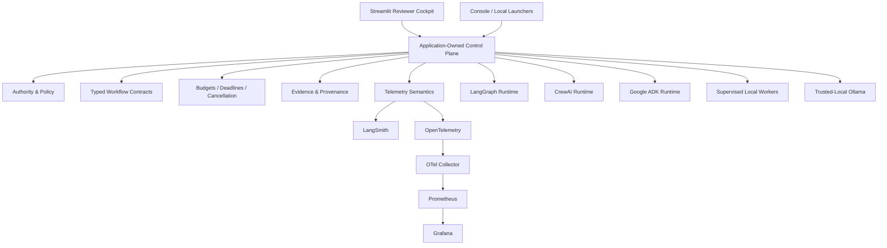

# Module 6 — Multi-Agent Systems & Orchestration


## Executive Summary

**What.** Module 6 is a production-grade multi-agent orchestration system that demonstrates sequential, parallel, hierarchical, coordinator-worker, collaborative, and distributed execution patterns across LangGraph, CrewAI, and Google ADK.

**How.** Application-owned contracts control authority, policy, cost, evidence, and telemetry semantics while orchestration frameworks remain interchangeable runtime implementations behind those boundaries. Deterministic agents provide a zero-key reviewer path; a separate trusted-local path supports real local Ollama inference.

**Why.** Multi-agent systems need more than framework demos. They need explicit authority boundaries, validated hand-offs, bounded execution, cost controls, failure semantics, evidence provenance, observability, and reviewer-visible proof.

**Proof.** The accepted implementation includes genuine LangGraph, CrewAI, and Google ADK orchestration; supervised distributed worker execution; bounded local scaling evidence; LangSmith AI/agent tracing; OpenTelemetry → Collector → Prometheus → Grafana operational observability; real-local Ollama execution; an independently accepted release; and a deployed six-tab Streamlit reviewer cockpit.

---

## Start Here / Reviewer Path

### Public reviewer path

Open the deployed Streamlit cockpit:

**https://dm-aiep-modules-module-06.streamlit.app**

Recommended review order:

1. **Guide** — understand evidence classes, trust boundaries, and deployment limits.
2. **Deterministic Demo** — run a real orchestration path with deterministic agents and no model inference.
3. **Live / BYOK** — inspect the trusted-local live boundary; public live is unavailable by design.
4. **Operations** — compare recorded local telemetry verification with a fresh current-host check.
5. **LangSmith Tracing** — compare `service_read` with `unverified_write`.
6. **Implementation Evidence** — inspect curated architecture-to-code proof for the major frameworks and observability boundaries.

For detailed hands-on walkthroughs, expected results, failure exercises, and evidence interpretation, use the [User Guide](docs/USER_GUIDE.md).

### Reviewer posture

The public deployment is intentionally:

- deterministic;
- keyless;
- useful without external services;
- fail-closed for public live execution;
- explicit about recorded vs fresh evidence.

Nothing executes, queries, or delivers merely because the page renders.

---

## Key Capabilities

| Capability | Evidence / reviewer surface |
| --- | --- |
| Sequential, parallel, hierarchical, and coordinator-worker orchestration | LangGraph deterministic demonstrations |
| Collaborative multi-agent task execution | CrewAI deterministic demonstration |
| Native delegated workflow/session execution | Google ADK deterministic demonstration |
| Distributed orchestration | Independent local worker processes with serialized IPC, start barrier, worker PIDs, and reaping evidence |
| Canonical Researcher → Analyst → Critic workflow | Synthetic offline and trusted-local real-inference paths |
| Validated hand-offs and workflow-scoped state | Typed immutable contracts revalidated at each boundary |
| Bounded autonomy | Step budgets, deadlines, cancellation, bounded repair, zero automatic retry in accepted live profile |
| Local scaling evidence | Opt-in bounded benchmark at admission caps 1, 2, and 4 |
| Real local inference | Trusted-local Ollama path |
| AI/agent tracing | LangSmith delivery/read-back evidence with explicit classifications |
| Operational observability | OpenTelemetry → Collector → Prometheus → Grafana, verified locally |
| Reviewer experience | Six-tab Streamlit cockpit with built-in guidance and evidence labels |

### Evidence classes

Module 6 deliberately separates:

- `deterministic_demo`
- `synthetic_offline`
- `local_provider_execution`
- `recorded_historical`
- `fresh_execution`
- `service_read`
- `unverified_write`

A recorded event never substitutes for a failed current action, and a successful write is never promoted to a service-read confirmation without evidence.

---

## Architecture



The application—not the model or orchestration framework—owns:

- execution authority;
- workflow policy;
- typed contracts;
- cost and deadline limits;
- evidence classification;
- telemetry semantics.

Model, provider, user, and tool text are untrusted data.

### Runtime roles

- **LangGraph** — graph topology compilation and native async scheduling.
- **CrewAI** — collaborative task scheduling through genuine CrewAI primitives.
- **Google ADK** — native workflow, agent, session, runner, and event execution.
- **Ollama** — trusted-local real model inference.
- **LangSmith** — specialist AI/agent trace delivery and verification boundary.
- **OpenTelemetry stack** — operational metrics collection and dashboarding.

---

## Technology Stack

| Area | Technology |
| --- | --- |
| Language | Python 3.12 |
| Validation / contracts | Pydantic |
| Graph orchestration | LangGraph |
| Collaborative agents | CrewAI |
| Agent runtime | Google Agent Development Kit (ADK) |
| Local inference | Ollama |
| AI/agent tracing | LangSmith |
| Operational telemetry | OpenTelemetry / OTLP |
| Metrics collection | OpenTelemetry Collector |
| Metrics store / alerting | Prometheus |
| Dashboards | Grafana |
| Reviewer UI | Streamlit |
| Quality | Ruff, pytest, compileall |
| Packaging / execution | `uv` |

The reviewer cockpit does not iframe or embed Grafana, Prometheus, or LangSmith. It curates their accepted evidence natively while preserving each system's specialist role.

---

## Production-Grade Engineering

### Application-owned control plane

Framework execution sits behind stable application contracts. Runtime-specific behavior cannot silently redefine:

- authority;
- task identity;
- workflow scope;
- evidence classification;
- cost policy;
- telemetry semantics.

### Bounded execution

The accepted NORMAL trusted-local profile uses:

- workflow budget: `200000 ms`;
- per-call budget: `45000 ms`;
- maximum model calls: `4`;
- maximum repair attempts: `1`;
- transport retries: `0`;
- concurrency: `1`.

Additional controls include:

- explicit step budgets;
- deadlines;
- cancellation;
- supervised child processes;
- kill/reap cleanup;
- fail-closed denial;
- no automatic fallback;
- no automatic retry.

### Distributed execution

Distributed demonstrations use independent local worker processes with:

- serialized IPC;
- explicit start barrier;
- process identity evidence;
- bounded supervision;
- cleanup and reaping evidence.

This establishes local process distribution, not remote-cluster or cloud distribution.

### Scaling evidence

The local scaling benchmark evaluates bounded admission caps and validates:

- requested vs completed workflows;
- peak concurrency;
- worker cleanup;
- workflow invariants.

Speedup is not a pass criterion and is not generalized into a production-capacity claim.

### Reviewer-visible proof

The Streamlit cockpit exposes:

- runnable deterministic workflows;
- failure controls;
- evidence provenance;
- historical vs current-state distinctions;
- recorded vs externally verified observability;
- curated source evidence.

Business and orchestration logic remain outside the presentation layer.

---

## Security and Trust Boundaries

### Deterministic public posture

The deployed reviewer path is:

- no-key;
- deterministic;
- no live model execution;
- no automatic external telemetry delivery.

### Trusted-local live posture

Real local inference is available only through the separate private-local launcher and trusted runtime capability.

The UI does not accept secrets.

Each real live run requires:

- explicit operator action;
- fresh single-use `LiveAuthorization`;
- bounded execution under the fixed NORMAL profile.

Credential presence never grants authority.

### Public live fail-closed

Public/deployed live execution is intentionally unavailable.

No deployment-compatible authority boundary has been accepted, so a public visitor cannot execute the operator's local live path.

### Untrusted data

User, model, provider, workflow, and tool text are data, not authority.

No untrusted value flows into the cockpit's one static `unsafe_allow_html` CSS surface.

### External observability boundaries

- no automatic LangSmith write on page render;
- no automatic Operations query on page render;
- current checks require explicit user action;
- current-host Operations checks are allowlisted to fixed loopback endpoints;
- LangSmith current inspection requires a separately supplied trusted read capability;
- recorded evidence is never substituted for missing fresh evidence.

These controls establish tested trust and authority boundaries; they do not claim universal prompt-injection immunity or formal production security certification.

---

## Testing and Verification

Module 6 verification is evidence-class aware.

### Accepted release evidence

- annotated release: `v0.6.0-module-6`
- all 26 source requirements reconciled as `Verified with limitation`
- Module 6 automated suite: **2807 passed**
- separate targeted UI/semantic subset: **236 passed**

The `236` subset is **not additive** to the `2807` suite total.

### Google ADK acceptance

The accepted Google ADK implementation genuinely executes Coordinator → Specialist → Validator using Google ADK 2.11.0 runtime primitives including application-owned custom agents, workflow/session execution, an in-memory runner, and event-driven orchestration.

### Local operational telemetry verification

The accepted local observability verification recorded:

- 14 of 14 workflows;
- 3 alert rules loaded;
- Grafana dashboard provisioned;
- OpenTelemetry → Collector → Prometheus → Grafana verified end-to-end locally.

The Collector runs a metrics pipeline only. Operational traces and logs do not have a storage backend in this stack.

### LangSmith evidence

Accepted evidence includes:

- one deterministic trace with `service_read` confirmation;
- Run 5 with `unverified_write` classification.

Those facts are intentionally not collapsed into a generic delivered state.

### Real-local evidence

Accepted historical real-local evidence includes separately classified runs such as:

- Run 3 — `out_of_policy_observation`
- Run 4 — authorized current-path real-local verification
- Run 5 — live-model LangSmith projection/delivery verification with `unverified_write`

Four recorded real runs are treated as a floor, not as a proven lifetime total.

---

## Run Locally

### Deterministic reviewer cockpit

From the repository root:

```powershell
uv sync --locked --offline
uv run --locked --offline python module-06/run_console.py
```

Open the loopback URL printed by the launcher, normally:

`http://127.0.0.1:8501`

Recommended first actions:

1. open **Guide**;
2. run one workflow on **Deterministic Demo**;
3. inspect evidence, role order, and local trace;
4. try a bounded failure;
5. review **Operations** and **LangSmith Tracing**;
6. finish with **Implementation Evidence**.

Use synthetic, non-sensitive text.

### Focused test suite

```powershell
uv run --locked --offline pytest module-06/tests -q
```

### Trusted-local Live/BYOK

For a trusted private operator only:

`module-06/run_local_live.py`

This serves `private_local_app.py` on loopback and injects the trusted application-owned runtime capability.

Do not expose the private/local launcher publicly. It is not a public multi-user service and does not establish authentication, capacity, or SLA claims.

---

## Documentation / Deep Dives

- [User Guide](docs/USER_GUIDE.md) — hands-on reviewer walkthroughs, expected results, failure exercises, evidence labels, and troubleshooting
- [Source Requirements](docs/SOURCE_REQUIREMENTS.md)
- [Traceability](docs/TRACEABILITY.md)
- [Project Status](docs/PROJECT_STATUS.md)
- [Architecture](docs/ARCHITECTURE.md)
- [Security](docs/SECURITY.md)
- [Cost Governance](docs/COST_GOVERNANCE.md)
- [Observability](docs/OBSERVABILITY.md)
- [Operations Console](docs/OPERATIONS_CONSOLE.md)
- [Reviewer Experience Contract](docs/REVIEWER_EXPERIENCE_CONTRACT.md)
- [Scaling Benchmark](docs/SCALING_BENCHMARK.md)
- [LangSmith Delivery](docs/LANGSMITH_DELIVERY.md)
- [Canonical Live Workflow](docs/CANONICAL_LIVE_WORKFLOW.md)
- [Portfolio README](../README.md)
- Source: [`src/multi_agent_orchestration/`](src/multi_agent_orchestration/), [`app.py`](app.py), [`tests/`](tests/)

Per-slice historical records under `docs/` may contain earlier planning terminology. For current requirement status, use [Traceability](docs/TRACEABILITY.md).

---

## Evidence and Limitations

| Area | Established evidence | Not established |
| --- | --- | --- |
| LangGraph | Genuine graph compilation/execution; deterministic scheduling; fan-out/fan-in and coordinator-worker behavior | Model reasoning or hosted orchestration |
| CrewAI | Genuine CrewAI agent/task/crew scheduling with validated application contracts | Live model inference in the deterministic path |
| Google ADK | Genuine native ADK workflow/agent/session/runner execution | Hosted Google agent service deployment |
| Distributed execution | Independent supervised local worker processes, serialized IPC, PID and reaping evidence | Remote-host or cluster distribution |
| Canonical synthetic workflow | Validated Researcher → Analyst → Critic path, accounting, repair, local observation | LLM reasoning or provider execution |
| Ollama live | Genuine trusted-local model execution | Hosted-provider support or model-quality claims |
| Scaling | Bounded local single-host benchmark | Production capacity, cloud scale, SLA, portable performance |
| LangSmith | `service_read` for one deterministic trace; separate `unverified_write` for Run 5 | Universal delivery confirmation or current read capability in the public cockpit |
| OpenTelemetry stack | Local end-to-end metrics pipeline verified through Grafana | Hosted Grafana/Prometheus, production telemetry, trace/log storage |
| Public Streamlit | Deployed deterministic/no-key reviewer cockpit | Public live model execution or production deployment |

Additional limitations:

- evidence is primarily local, single-host, and bounded;
- one benchmark sample on one workstation does not establish capacity;
- no production load test;
- no SLA;
- no cloud-scale claim;
- no persistent shared memory claim;
- no remote-host distribution claim;
- model output quality is not claimed;
- the live repair path remains unexercised;
- one live-execution timing test is retained as a known load-sensitive reliability observation for future hardening;
- the public deployment intentionally leaves Live/BYOK unavailable;
- hosted Grafana and Prometheus are not claimed;
- production deployment is not claimed.

For the full six-system progression, see the [portfolio README](../README.md).

---

Developed from Techademy AI Engineering program requirements. Independent implementation and production-grade engineering enhancements.
