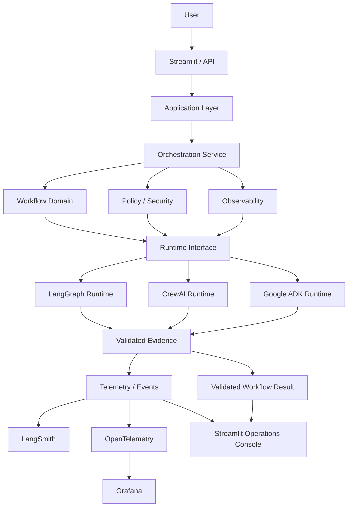
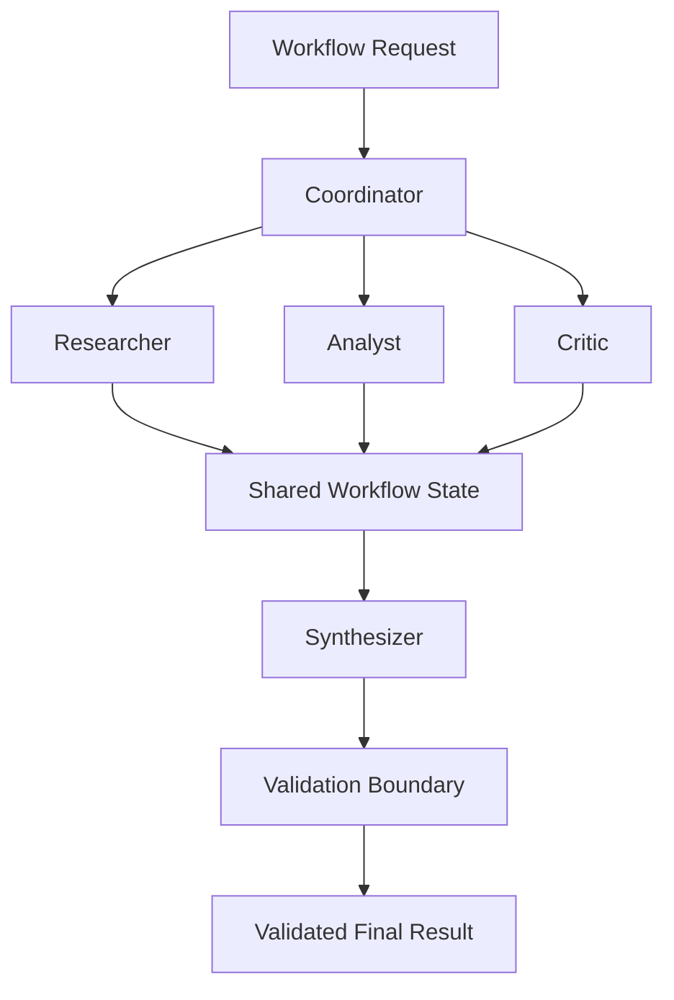
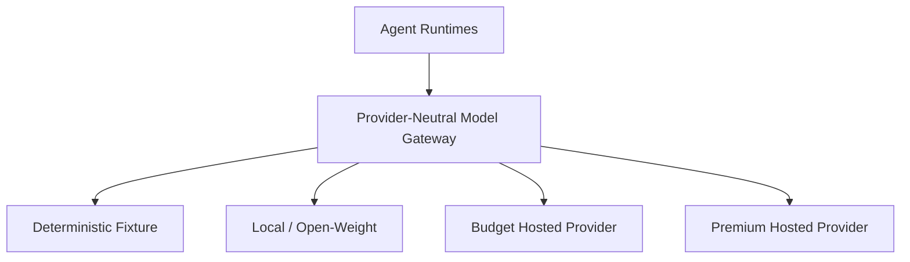

# Module 6 Architecture

## Status

**Architecture B+ - APPROVED AND FROZEN**

Material changes to trust boundaries, source coverage, runtime ownership,
security posture, or cost exposure require explicit human review and an ADR.

## Goal

Build a production-grade, provider-neutral multi-agent orchestration platform.

The application owns its workflow semantics, contracts, policy, security,
cost governance, evidence model, and telemetry semantics.

LangGraph, CrewAI, and Google ADK are runtime implementations behind
application-owned boundaries.

## Core Principle

> Frameworks are implementation mechanisms. Application contracts, authority,
> policy, workflow semantics, evidence, and cost controls belong to the application.

## B+ Platform Architecture

## Reference Collaborative Workflow

## Runtime Responsibilities

### LangGraph

Primary runtime for stateful coordinator-worker workflows, sequential execution,
parallel fan-out/fan-in, hierarchical routing, workflow state, conditional
transitions, and bounded execution.

### CrewAI

Primary runtime for collaborative role-based agents, the collaborative AI lab,
specialist task collaboration, and collaborative task/result exchange.

### Google ADK

Primary runtime for the distributed-orchestration lab, ADK-native multi-agent
delegation, and distributed-processing evidence where technically justified.

Genuine distribution must be distinguished from simulation.

### LangSmith

Required AI execution observability for agent/LLM traces, model-call evidence,
runtime debugging, and trace correlation.

LangSmith does not own application telemetry semantics.

## Three-Layer Observability

### Streamlit

Primary interactive product and curated per-run engineering-evidence surface.

### LangSmith

Answers: What happened inside the AI/agent execution?

### Grafana

Answers: How is the production system behaving across executions and over time?

### OpenTelemetry

Preferred vendor-neutral operational instrumentation boundary.

Grafana must remain replaceable without changing orchestration semantics.

## Model Gateway

Selection is governed by capability, security, quality, availability, and cost.

OpenCode may be used as an engineering agent/client. A hosted gateway such as
OpenCode Zen may be evaluated only after its production API contract, security,
terms, availability, and pricing are verified.

OpenCode itself is not automatically part of the production serving path.

## Execution Modes

1. Deterministic fixture - zero billable calls, CI-safe, reproducible.
2. Local/open-weight - optional, no external inference charge.
3. Budget hosted - explicitly authorized and budget bounded.
4. Premium hosted - explicitly authorized and used only when justified.

Credential presence alone must never authorize paid execution.

## Standalone Boundary

Module 6 must not import application code from Modules 1-5.

## Architecture Freeze

- avoid unnecessary structural refactoring;
- change architecture only for a demonstrated design problem;
- implement incrementally;
- observe real duplication before extracting shared runtime utilities;
- preserve source faithfulness, security, reliability, cost efficiency, and
  defensible evidence as hard invariants.
