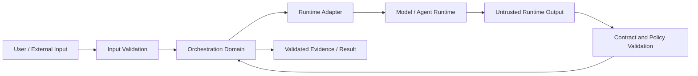

# Module 6 Security

## Status

Initial production-grade threat model for Architecture B+.

## Core Trust Rule

External input, retrieved content, model output, agent output, tool output,
memory, runtime output, and remote telemetry responses are untrusted until
validated at the appropriate application boundary.

An LLM or agent may recommend an action. It does not acquire application
authority merely by recommending it.

## Trust Boundary

## Required Control Families

- typed input, state, task, result, and evidence contracts;
- capability allowlists;
- explicit authority boundaries;
- prompt-injection containment;
- bounded retries and iteration counts;
- timeouts and cancellation;
- concurrency and resource limits;
- output validation;
- state-transition validation;
- provider allowlisting;
- secret redaction;
- zero-key default startup;
- explicit authorization for billable execution;
- no unnecessary secret propagation into prompts or traces;
- trace and log redaction;
- safe error handling;
- denial and audit evidence;
- adversarial tests for expected attack paths.

## High-Priority Threats

1. Prompt injection altering privileged behavior.
2. Agent output forging authority or workflow state.
3. Cross-agent context poisoning.
4. Unbounded delegation loops.
5. Retry storms and runaway spend.
6. Tool or runtime capability escalation.
7. Secret leakage through logs, traces, prompts, UI, or errors.
8. Unsafe telemetry rendering or logging.
9. Distributed worker replay or duplicate execution.
10. Unsafe fallback behavior after provider or runtime failure.
11. Cross-run state contamination.
12. Public deployment exposing administrative or provider credentials.

## Authority Boundary

Model and agent output is data, not authority.

No model-generated field may directly:

- grant a capability;
- expand a provider allowlist;
- authorize spending;
- bypass validation;
- alter security policy;
- increase its own execution budget;
- mark its own evidence as trusted.

Privileged changes require application-owned policy and, where specified,
explicit human authorization.

## Security Evidence

A security claim is not complete until supported by evidence appropriate to
the risk.

Security tests must never be removed or weakened merely to obtain green status.
